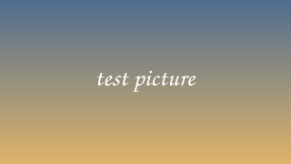

# Images checklist

Open this note in Ghostty (or kitty) with snacks.nvim's images on, and check
each item. The automated tests can't see images. The checks are in
`>> note` blocks; the cases follow them.

## Headings

>> note
The two headings above and below are images: # 1.5 times the text's size, ## 1.25 times, each two rows tall, in their heading colors. On the cursor's line a heading shows as text. Make the window narrow: a long heading wraps onto more rows instead of shrinking.
<<

## A section heading long enough to wrap when the window is made narrow

## Formulas

>> latex
x^2 = y^3
\sum_{i=1}^{n} i \leq \frac{n^2}{2}
<<

>> note
The block above shows two typeset formulas in white, one per line, centered, with no >> showing to their left. With the cursor in the block, its LaTeX shows instead. Inline math is typeset within the line: $e^{i\pi} + 1 = 0$.
<<

## Diagrams

>> mermaid
graph LR
  source --> compiler --> program
<<

>> note
The diagram above is centered, in colors matching the note, at most 20 rows tall and 80% of the window's width.
<<

## Pictures

>> note
The picture above is centered, with "a test picture" under it as a dim, italic caption.
<<

## Resizing

>> note
Open another window beside this one, then close it: every image comes back, re-centered, within about a second.
<<

## Reading mode

>> note
Run :read. The images stay shown, except an image on the cursor's line, which snacks.nvim shows as its text until the cursor moves off. Esc leaves reading mode.
<<
